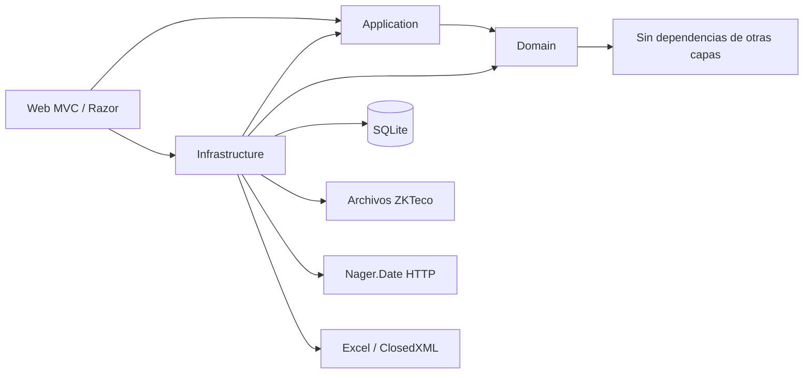
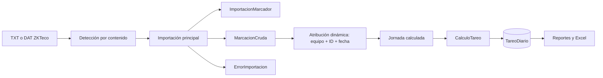
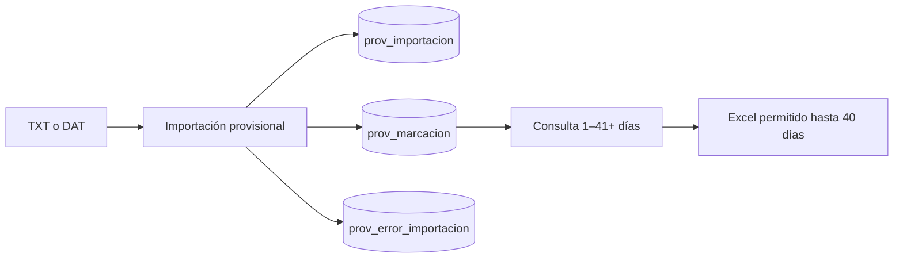

# Arquitectura estable

## Resumen

Control de Marcaciones es un monolito modular por capas, desplegado como aplicación ASP.NET Core MVC/Razor sobre .NET 10, EF Core 10 y SQLite. Procesa archivos de marcadores ZKTeco, atribuye marcas a trabajadores, calcula tareo diario y genera reportes operativos. PMV es un ramal provisional de consulta y exportación, deliberadamente aislado del flujo principal.

## Diagramas de referencia

- [D01 — contexto](diagrams/D01_SYSTEM_CONTEXT.md)
- [D02 — contenedores/capas](diagrams/D02_CONTAINERS_LAYERS.md)
- [D03 — componentes backend](diagrams/D03_BACKEND_COMPONENTS.md)
- [D04 — navegación frontend](diagrams/D04_FRONTEND_NAVIGATION.md)
- [D05 — dominio](diagrams/D05_DOMAIN_MODEL.md)
- [D06 — ERD](diagrams/D06_DATABASE_ERD.md)
- [D07 — importación ZKTeco](diagrams/D07_ZKTECO_IMPORT_FLOW.md)
- [D08 — marca a jornada](diagrams/D08_MARKING_TO_WORKDAY.md)
- [D09 — jornada a tareo](diagrams/D09_WORKDAY_TO_TAREO.md)
- [D10 — rotación](diagrams/D10_SHIFT_ROTATION.md)
- [D11 — solicitudes/justificaciones/reintegros](diagrams/D11_REQUEST_JUSTIFICATION_REINTEGRO.md)
- [D12 — reportes](diagrams/D12_REPORT_GENERATION.md)
- [D13 — dependencias de módulos](diagrams/D13_MODULE_DEPENDENCIES.md)
- [D14 — flujo PMV](diagrams/D14_PMV_DATA_FLOW.md)

Mermaid es la fuente visual versionable. [CONTROL_MARCACION_ARCHITECTURE.drawio](diagrams/CONTROL_MARCACION_ARCHITECTURE.drawio) es únicamente una vista editable de alto nivel.

## Arquitectura física

Un proceso ASP.NET Core sirve MVC/Razor y ejecuta Application/Domain/Infrastructure dentro del mismo despliegue. SQLite es la persistencia local. Los límites externos son archivos ZKTeco/padrones, Nager.Date y archivos Excel. No hay nodos de microservicios ni cola confirmados.

## Arquitectura funcional

Los módulos comparten proceso y base, pero separan responsabilidades mediante contratos de Application y agregados/servicios de dominio. Importación principal alimenta marcaciones y tareo; PMV conserva un ramal de staging sin efectos sobre el tareo oficial.

## Dependencias

Dependencias permitidas:

- `Domain`: entidades, reglas puras, validadores y excepciones; no conoce EF, Web ni Infrastructure.
- `Application`: contratos, DTO y algunos servicios de orquestación; depende de Domain.
- `Infrastructure`: persistencia EF/SQLite, lectores, exportadores y proveedores externos; depende de Application y Domain.
- `Web`: composición, controladores, modelos, Razor, autenticación/autorización; depende de Application e Infrastructure.

La referencia directa Web → Infrastructure es intencional en la raíz de composición. El acceso directo a `MarcacionDbContext` en arranque, Identity y el proveedor HTTP de alcance está acotado al borde técnico; no debe extenderse a lógica de negocio.

## Primer arranque local

El hosting Windows local separa proceso vivo de readiness mediante cuatro estados:
`Starting`, `SetupRequired`, `Ready` y `Failed`. Una base compatible sin usuarios no es un
error de migración: sirve el wizard Web `/setup`, mientras `/estado` responde 503 con
`CONFIGURACION_INICIAL_REQUERIDA`. El alta inicial usa Identity y queda cerrada tan pronto
existe un usuario. Un esquema incompatible permanece en `ERROR` y nunca habilita el wizard.

El launcher es infraestructura de borde: selecciona puerto y URL, pero no altera reglas de
negocio. Solo enlaza `127.0.0.1`; abre `/setup` para SetupRequired, `/` para Ready y muestra un
diálogo local para Failed. El instalador no conoce credenciales.

## Fuentes de verdad

- Evidencia de entrada: archivo importado, cabecera y marca cruda.
- Regla vigente: `ACCEPTANCE_RULES.md`; catálogo/linaje: `BUSINESS_RULES.md`.
- Resultado operativo: `TareoDiario` persistido.
- Estructura física: `DATABASE.md` y configuración EF específica.
- Prioridad de remediación: `REMEDIATION_PLAN.md`.

## Límites del dominio

Domain calcula y valida sin conocer HTTP, EF o Excel. Application expresa casos de uso/contratos. Infrastructure resuelve persistencia e integraciones. Web traduce solicitudes y compone. Jornada permanece dentro del cálculo: no es agregado persistido.

## Excepciones arquitectónicas conocidas

- Web referencia Infrastructure para composición y usa DbContext en puntos acotados de inicio/Identity/alcance.
- **SUPERADA:** el motor y reportes leían campos planos de trabajador. Desde 3C usan
  `PeriodoLaboral`/`AsignacionPlanta`; los planos quedan para estado actual y compatibilidad.
- PMV comparte lectores con importación principal, pero mantiene tablas y efectos separados.

## Módulos funcionales

| Módulo | Responsabilidad | Documento |
|---|---|---|
| Personal | ficha, vigencias, padrón, cese y carga masiva | [PERSONNEL](modules/PERSONNEL.md) |
| Marcaciones | lectura, importación, origen y atribución | [MARKINGS](modules/MARKINGS.md) |
| Turnos y rotaciones | horarios versionados, cuadrillas y programación | [SHIFTS_ROTATIONS](modules/SHIFTS_ROTATIONS.md) |
| Asistencia y tareo | construcción de jornada, cálculo e incidencias | [ATTENDANCE_TAREO](modules/ATTENDANCE_TAREO.md) |
| Solicitudes y justificaciones | ausencias, sustento, aprobación y regularización | [REQUESTS_JUSTIFICATIONS](modules/REQUESTS_JUSTIFICATIONS.md) |
| Reportes | consultas, reintegros y Excel final | [REPORTS](modules/REPORTS.md) |
| Seguridad | Identity, roles y alcance por planta | [SECURITY](modules/SECURITY.md) |
| PMV | staging provisional aislado | [PROVISIONAL_MARKINGS](modules/PROVISIONAL_MARKINGS.md) |

## Flujo principal

La jornada no es una tabla: se reconstruye con marcas, atribución, vigencias, turno/rotación, feriados, justificaciones y parámetros. `TareoDiario` sí persiste el resultado. Los reportes leen tareo persistido; no recalculan el dominio.

## Flujo provisional PMV

PMV reutiliza los lectores, atribuye dinámicamente y no persiste trabajador. No escribe `ImportacionMarcador`, `MarcacionCruda` ni `TareoDiario`. Su aislamiento funcional es correcto; su ausencia de alcance por planta es un P0 de seguridad.

## Persistencia

- SQLite canónica: 49 tablas físicas, 45 claves foráneas, 87 índices explícitos, 32 únicos y 9 parciales.
- Catorce migraciones aplicadas; sin triggers ni vistas.
- EF Core usa configuraciones por agregado y convenciones explícitas.
- La integridad estructural física fue verificada; la base canónica se inspeccionó en modo lectura.
- **OBSOLETA — evidencia histórica:** se observaron 85 grupos/170 filas en un corte antiguo. La
  copia controlada 3B contemporánea contenía 307 trabajadores con múltiples abiertos, 868 filas
  involucradas y 900 solapamientos; el saneamiento dejó todos esos conteos en 0 y añadió 352
  asignaciones de planta Nivel A. Producción no fue tocada ni queda caracterizada por esos números.

## Temporalidad y fuentes de verdad

- Vigencias relevantes: asignaciones, horarios de turno, programación de cuadrillas y periodos.
- La atribución de marcaciones es dinámica por equipo, identificador y fecha.
- `PeriodoLaboral` es la autoridad histórica de vínculo y empresa; `AsignacionPlanta`, la de
  planta dentro del vínculo. Cálculo, reportes y consumidores históricos resuelven por fecha
  mediante `ConsultaContextoLaboral`.
- `Trabajador.FechaIngreso`, `FechaCese`, `EmpresaId` y `PlantaId` son proyección actual y
  compatibilidad. No constituyen historia ni fallback para consumidores migrados.
- El tareo persistido no congela todos los insumos que permitieron calcularlo. La alerta de frescura es incompleta y puede ocultar recálculo parcial.
- Un reporte histórico puede variar por datos maestros actuales. La reproducción exacta requiere snapshot o resolución histórica aún no diseñada.

## Reglas arquitectónicas que no deben reinterpretarse

- 480 minutos es comportamiento defectuoso observado en el cálculo de ciertos escenarios, no la regla vigente universal.
- La jornada diurna ordinaria confirmada es 07:00–17:22.
- La tardanza de planilla tiene tolerancia 0; un campo configurable de 5 minutos pertenece a otra semántica técnica/operativa.
- 14+1+7 es un patrón operativo observado, no una rotación universal ni infinita.
- El descanso móvil no se representa naturalmente porque `TramoRotacion` exige `TurnoId`.

## Integraciones y límites

- Archivos ZKTeco TXT y respaldo binario DAT.
- Nager.Date para feriados externos, con persistencia local posterior.
- ClosedXML para exportación Excel.
- ASP.NET Core Identity y cookies para identidad y roles.
- No se observaron colas, microservicios, API pública ni integración de nómina automática.

## Despliegue observado

El repositorio contiene una aplicación web que puede publicarse como ejecutable autocontenido. Los ejecutables desplegados, `bin/`, `obj/`, archivos comprimidos y copias de base no son fuentes arquitectónicas. Configuración sensible y credenciales requieren gestión externa; no deben inferirse de artefactos de despliegue.

## Riesgos dominantes

1. Exactitud de pago: horas extra, tardanza, liquidación y supresión de incidencias.
2. Confidencialidad: PMV no aplica alcance por planta.
3. Integridad temporal: `PeriodoLaboral` quedó cerrado técnicamente; persisten el riesgo de
   SQL directo sobre solapamientos cerrados y la mutabilidad de otros maestros de reporte.
4. Vigencia: invalidación incompleta del tareo y posibilidad de falso “actualizado”.
5. Robustez: importación principal con dos commits sin transacción común.

Véanse [TECHNICAL_DEBT.md](TECHNICAL_DEBT.md) y [REMEDIATION_PLAN.md](REMEDIATION_PLAN.md).

## Decisiones válidas que no constituyen deuda por sí mismas

- Mantener un monolito para este alcance.
- Usar MVC/Razor para la interfaz actual.
- Alojar `MarcacionDbContext` en Infrastructure.
- Mantener Jornada como concepto calculado, no como tabla.
- Usar DbContext desde la composición/seguridad Web en los puntos acotados ya documentados.
# Hosting temporal local (2026-10-12)

El ejecutable self-contained conserva ASP.NET Core MVC y Kestrel, enlazado solo a 127.0.0.1.
Binarios y estado mutable se separan entre Program Files y ProgramData. Esta topología no
reemplaza la arquitectura futura en servidor y no introduce dependencias de negocio al puerto.

## Adaptador diagnóstico ZKTeco PULL SDK (2026-10-13)

La abstracción vigente continúa siendo `Application.IFuenteDeMarcaciones`. Infrastructure
contiene el lector interno, el adaptador PULL SDK y el comparador; Domain y Application no
referencian DLL ZKTeco. `plcommpro.dll` se carga dinámicamente desde un directorio explícito
solo en modo `Sdk` o `Comparar`, después de validar PE x64. El modo por defecto `Interno` no
carga el SDK. `Comparar` usa el lector interno como única fuente autoritativa y genera evidencia
sin duplicar persistencia. Ninguna DLL forma parte del publish o instalador.

## Contexto laboral histórico (2026-10-13)

`PeriodoLaboral` y sus `AsignacionPlanta` son la autoridad temporal para consumidores con una
fecha. `ConsultaContextoLaboral` es la puerta central de Infrastructure: carga el rango una vez,
resuelve en memoria y falla ante ambigüedad. Reportes y recálculo no consultan una fila por
trabajador/día. El alcance SQL de tareos se aplica por planta histórica de la propia fecha.

`Trabajador.EmpresaId`, `PlantaId`, `FechaIngreso` y `FechaCese` siguen siendo proyecciones
actuales para UI y comandos; no se eliminaron. La identidad física de una marca continúa
siendo equipo + ID de marcador + vigencia de `AsignacionMarcador`.

### Consolidación 3D–3E-E (2026-10-15)

Las escrituras cargan el agregado histórico completo, validan cardinalidad, contención,
continuidad y solapamientos, y persisten selectivamente sin marcar la historia cerrada como
modificada. Alta, cese, cambio de planta y reingreso mantienen en una sola transacción la
historia canónica y la proyección actual. El flujo de reingreso existe en Application/Web.

Cuadrillas y PMV histórico también usan el contexto de la fecha; no existe fallback silencioso
a `Trabajador.PlantaId`. La atribución física de marcas no cambió: equipo + ID de marcador +
vigencia de `AsignacionMarcador`.

Límites deliberados: los cuatro planos y el dual-write permanecen por compatibilidad; SQLite no
impide todos los solapamientos de periodos cerrados ni valida físicamente el rango completo de
`PeriodoLaboral`; no hay token de concurrencia propio del periodo. Dominio, servicio, transacción
e índices parciales cubren los flujos normales. Retirar columnas o intervenir producción exige
otra fase y una migración/operación autorizada.

Estado arquitectónico: **P1-DATA-PERIODOLABORAL CERRADO**. Evidencia en los dossiers 3B–3E-D;
producción y OP-03 permanecen intactos.

