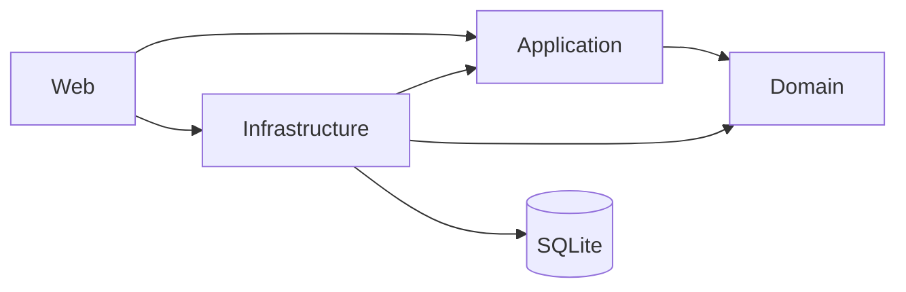

# Dossier maestro de ingeniería inversa

Versión consolidada: 2026-10-15. Integra las Fases 1–6 y el cierre formal de
`P1-DATA-PERIODOLABORAL`; las fases siguen como evidencia histórica.

## 1. Propósito del sistema

Control de Marcaciones administra personal y horarios, ingiere archivos ZKTeco, atribuye marcas, calcula asistencia/tareo diario y exporta resultados para operación y planilla. Busca preservar la evidencia cruda y aplicar reglas temporales de manera trazable.

## 2. Alcance

Incluye organización, personal, equipos, marcadores, importación, turnos/versiones, cuadrillas/rotaciones, asistencia, tareo, solicitudes, justificaciones, reintegros, reportes, seguridad, auditoría, parámetros y el staging PMV.

No se observaron microservicios, mensajería, API pública, SPA ni integración automática con nómina. Fase 6 solo consolidó documentación: no cambió producción, base, datos ni pruebas.

## 3. Stack

- .NET 10 y ASP.NET Core MVC/Razor.
- Entity Framework Core 10 y SQLite.
- ASP.NET Core Identity con cookies.
- ClosedXML para Excel.
- Lectores propios ZKTeco TXT/DAT.
- Nager.Date para feriados externos que luego se persisten.

## 4. Arquitectura

Es un monolito modular por capas, no microservicios.



Web contiene composición, MVC y seguridad HTTP. Application define contratos/DTO. Infrastructure implementa EF, archivos, HTTP y Excel. Domain contiene entidades/reglas sin depender de las otras capas. Web → Infrastructure es válida en composición. Los usos directos de DbContext en inicio, Identity y alcance HTTP son excepciones de borde acotadas.

## 5. Módulos

| Módulo | Responsabilidad | Ficha |
|---|---|---|
| Organización | empresas, plantas, áreas, centros y secciones | [PERSONNEL](modules/PERSONNEL.md) |
| Personal | ficha, vigencias, vínculo, cese y padrón | [PERSONNEL](modules/PERSONNEL.md) |
| Equipos/marcadores/importación | origen, lectura y marca cruda | [MARKINGS](modules/MARKINGS.md) |
| Turnos/versiones/cuadrillas/rotaciones | horario por fecha | [SHIFTS_ROTATIONS](modules/SHIFTS_ROTATIONS.md) |
| Asistencia/tareo | jornada calculada y `TareoDiario` | [ATTENDANCE_TAREO](modules/ATTENDANCE_TAREO.md) |
| Solicitudes/justificaciones | trámite y regularización | [REQUESTS_JUSTIFICATIONS](modules/REQUESTS_JUSTIFICATIONS.md) |
| Reintegros/reportes | ajustes, consultas y Excel | [REPORTS](modules/REPORTS.md) |
| PMV | staging provisional aislado | [PROVISIONAL_MARKINGS](modules/PROVISIONAL_MARKINGS.md) |
| Seguridad/auditoría | usuarios, roles, plantas y trazas | [SECURITY](modules/SECURITY.md) |
| Configuración/parámetros | catálogos y parámetros legales | [BUSINESS_RULES_FINAL](BUSINESS_RULES_FINAL.md) |

## 6. Modelo de dominio

`Trabajador` y asignaciones modelan personal. Turnos, versiones, cuadrillas y programaciones resuelven el horario. `ImportacionMarcador` y `MarcacionCruda` conservan evidencia. `CalculoTareo` expresa el algoritmo; `TareoDiario` guarda su resultado. Solicitudes, justificaciones, incidencias y reintegros complementan la interpretación sin reemplazar marcas crudas. Véanse D05/D06.

## 7. Modelo temporal

- `AsignacionMarcador`: identificador/equipo del trabajador por vigencia.
- `AsignacionArea`, `AsignacionTurno`, `AsignacionSueldo`: dimensión o condición aplicable por fecha.
- `PeriodoLaboral`: autoridad histórica de vínculo laboral y empresa por fecha.
- `AsignacionPlanta`: autoridad histórica de planta dentro de cada vínculo.
- `VersionTurno`: horario efectivo del turno por vigencia.
- `ProgramacionCuadrilla`: secuencia aplicable a una cuadrilla por fecha.

**OBSOLETA/SUPERADA:** motor y reportes usaban deliberadamente los campos planos de
`Trabajador`; el corte antiguo registró 85 grupos/170 filas y prohibía migrar consumidores antes
del saneamiento. Fases 3B–3C cumplieron ese gate. Hoy reportes, tareo, cuadrillas y PMV histórico
resuelven el contexto canónico sin fallback plano. `Trabajador.FechaIngreso`, `FechaCese`,
`EmpresaId` y `PlantaId` permanecen solo como proyección actual y compatibilidad.

## 8. Marcaciones

```text
ZKTeco → ImportacionMarcador → MarcacionCruda → atribución
```

El formato se detecta por contenido; se admite TXT/DAT, se obtiene serie y se valida equipo/origen. Cargas anuladas no cuentan. La atribución usa equipo + identificador + fecha, evitando colisiones entre aparatos. La importación principal tiene dos `SaveChanges` sin transacción común: P2 según la clasificación final de Fase 5.

## 9. Turnos

`Turno` da identidad; `VersionTurno` define horario vigente; `AsignacionTurno` vincula trabajador; `Cuadrilla` agrupa; `ProgramacionCuadrilla` calendariza; `TramoRotacion` representa cada tramo.

14+1+7 es patrón observado, no ciclo universal ni infinito. La arquitectura debe admitir tramos diurnos/nocturnos, duraciones distintas, programación futura y cambios manuales sin alterar el pasado. El descanso dentro de una rotación es de un día. Gap P1: `TramoRotacion` exige `TurnoId` y no representa naturalmente ese descanso explícito.

## 10. Jornada

Jornada es un concepto calculado y no una entidad persistida. Se construye con marcas atribuidas, primera/última marca, rebotes, ventana, turno/rotación, calendario, cobertura, justificaciones y parámetros. No debe buscarse una tabla `Jornada`.

## 11. Tareo

```text
MarcacionCruda → atribución → turno → ventana → CalculoTareo
→ ResultadoCalculo → TareoDiario
```

Reglas vigentes críticas:

- Turnos regulares: DIU 07:00–17:22; NOC 19:00–05:22 del día siguiente.
- Lunes–viernes: ordinario hasta el fin teórico del turno. Un exceso menor a 15 min no es HE; desde 15 min se cuenta todo desde el fin teórico. Primeras 2 h extra al 25 %, resto 35 %.
- Sábado: todo trabajado es HE desde el primer minuto, sin umbral; primeras 2 h 25 %, resto 35 %.
- Domingo: descanso semanal; si se trabaja, todo el tiempo son horas extra al 100 % desde el primer minuto, sin descanso sustitutorio automático ni reparto ordinario/25/35.
- Planilla: tardanza con tolerancia 0 (07:01 = 1 minuto; 19:01 = 1 minuto).
- Salida anticipada de planilla: tolerancia 0 (17:21 = 1 minuto; 05:21 = 1 minuto).

Desde R-P0-02/R-P0-03.1 el motor aplica estas reglas contra el fin teórico del turno, sin usar 480 ni tolerancias de cinco minutos. La semilla todavía define DIU 07:00–19:00 y NOC 19:00–07:00: corregirla es una acción operativa con nueva versión de turno, no un cambio de código. El recálculo conserva entrada/salida reales aunque use regularizaciones.

## 12. Reportes

Los reportes leen `TareoDiario`, reintegros, marcadores/áreas historizados y parte de la ficha/maestros actuales; no recalculan. El Excel observado tiene cuatro hojas y 57 columnas A:BE. Referencias a tres hojas o AO:BF son históricas. Hay sanitización contra fórmulas y filtros de alcance, pero una reemisión cerrada puede variar por maestros no congelados.

## 13. Solicitudes y justificaciones

```text
Solicitud → sustento → aprobación/rechazo/anulación
→ justificación o regularización → recálculo → incidencia
```

Una justificación parcial no implica problema resuelto. INC-01..03 muestran que `JustificacionId` puede ocultar incidencia aunque falte salida o cobertura. La supresión debe depender del resultado resuelto. La aprobación parcial conserva decisiones pendientes.

`MarcacionCruda` no se modifica. REG-01..04 confirman que la regularización estándar conserva original, corrección, motivo, usuario, fecha, validación, workflow y bitácora. La composición con otras justificaciones y los borrados de evidencia derivada permanecen como hallazgos separados.

## 14. Reintegros

Los reintegros son ajustes separados del cálculo diario. Se consultan y presentan junto al reporte sin sustituir marcas ni reescribir el tareo original. Su trazabilidad permite distinguir cálculo base y corrección posterior.

## 15. PMV

PMV no es importación principal.

```text
.dat/TXT → IFuenteDeMarcaciones → ImportacionProvisional
→ MarcacionProvisional → atribución temporal → consulta → Excel
```

Usa `prov_importacion`, `prov_marcacion` y `prov_error_importacion`; comparte lectores, conserva archivo/hash/equipo y atribuye temporalmente. No persiste/modifica trabajador o asignaciones y no escribe `ImportacionMarcador`, `MarcacionCruda` o `TareoDiario`; tampoco calcula conceptos oficiales. 1–30 días normal; 31–40 advertencia; 41+ consulta permitida y exportación bloqueada. Defecto P0: falta alcance por planta.

## 16. Seguridad

Identity gestiona usuarios/roles. `UsuarioPlanta` e `IProveedorAlcancePlantas` delimitan plantas. El flujo principal tiene filtros y pruebas de servicio. PMV omite el alcance al listar, importar, consultar y exportar: es defecto conocido, no diseño deseado. Debe validarse en servicio y fallar cerrado; ocultar UI no basta.

## 17. Base de datos

Inspección canónica de solo lectura: 49 tablas, 45 FK, 87 índices explícitos, 32 únicos, 9 únicos parciales, un `CHECK`, 14 migraciones, sin triggers ni vistas. Estructura íntegra; eso no evita problemas funcionales como duplicados laborales. La base no tiene muestra representativa del flujo principal. Detalle en [DATABASE.md](DATABASE.md) y D06.

## 18. Reglas de negocio

El catálogo autoritativo vigente está en [BUSINESS_RULES_FINAL.md](BUSINESS_RULES_FINAL.md).
El corte de 108 reglas de Fase 6.1 permanece en [BUSINESS_RULES.md](BUSINESS_RULES.md)
como trazabilidad histórica. Comentarios antiguos o `CLAUDE.md` no prevalecen sobre
aceptación posterior.

No reinterpretar: 480 es defecto actual; tolerancia cinco no es regla de tardanza ni salida anticipada de planilla; 14+1+7 no es universal; domingo trabajado es íntegramente 100 %.

## 19. Tests

- Línea base anterior: 677/677 verdes.
- Corte histórico de Fase 5: **701 totales; 687 pasan; 14 fallan deliberadamente; 0 omitidas**.
- Corte ejecutado de Fase 6.2: Domain 309/293/16; Infrastructure 409/402/7.
- **CORTE HISTÓRICO SUPERADO:** 718 totales; 695 pasan; 23 fallan deliberadamente; 0 inesperados; 0 omitidos.
- Corte final `P1-DATA-PERIODOLABORAL`: **937/937 verdes; 0 fallos; 0 omitidos**;
  build Release 0 errores/0 warnings y regresión dirigida 108/108.

**HISTÓRICO — Fase 6.2:** las 23 rojas eran contratos que reproducían defectos conocidos; no
eran regresiones de la auditoría. Ese corte y su cobertura 84/16/8 quedaron superados por las
remediaciones posteriores. El detalle histórico permanece en
[ACCEPTANCE_FAILURES.md](ACCEPTANCE_FAILURES.md).

## 20. Performance

Baseline sintético PMV, una ejecución: importación 1k = 295.56 ms/6,334,744 B; 20k = 5,187.13 ms/65,656,336 B. Consultas 1/30/31/40/41 días = 127.17/1.65/6.72/2.00/4.57 ms; JSON = 585/14,709/15,195/19,578/20,064 B. Un día incluye arranque frío. No es SLA. No se midieron de forma equivalente tareo principal ni exportaciones completas.

## 21. Deuda y problemas conocidos

P0 (resueltos en código): corte en el fin teórico con umbral HE de 15 min, sábado sin umbral, domingo 100 %; tardanza 0; salida anticipada 0; aislamiento PMV. Pendiente operativo: reconfigurar DIU/NOC sembrados.

P1 históricos: doble conteo, duplicado/cese de `PeriodoLaboral`, incidencias, frescura, descanso
móvil e importación no atómica están resueltos en sus frentes. `P1-DATA-PERIODOLABORAL` queda
**CERRADO** en código, copia controlada, consumidores, UI y documentación. P1-06 permanece solo
para otros maestros históricos no congelados; ya no incluye vínculo, empresa ni planta.

P2: aprobación parcial, borrado físico, reglas de refrigerio/nocturnidad y tasas por empresa. P3: constantes dispersas, observabilidad, limpieza documental y retiro PMV. Clasificación estricta en [TECHNICAL_DEBT.md](TECHNICAL_DEBT.md); secuencia en [REMEDIATION_PLAN.md](REMEDIATION_PLAN.md).

## 22. Riesgos históricos

El tareo no congela todos los IDs, versiones y parámetros usados. Reportes todavía pueden mezclar
otros maestros actuales, por lo que una reemisión cerrada puede variar. **SUPERADO para vínculo,
empresa y planta:** la migración a `PeriodoLaboral`/`AsignacionPlanta` se realizó después del
saneamiento controlado. Cualquier snapshot/backfill adicional exige evidencia. Periodos cerrados
no se recalculan o reliquidan automáticamente.

## 23. Limitaciones

- Base canónica sin dataset representativo de marcas/tareo/rotación principal.
- Sin benchmark de tareo/reportes principales ni SLA acordado.
- Sin pruebas Web de autorización PMV.
- Frescura basada en fuentes incompletas y `MAX(CalculadoEn)`.
- Preguntas abiertas: refrigerio/nocturnidad, tasas, aprobación parcial, reliquidación y snapshot histórico.

## 24. Integraciones

Entradas: ZKTeco TXT/DAT y padrones CSV/Excel. Salidas: MVC y Excel ClosedXML. Nager.Date aporta feriados. SQLite es persistencia local. No se confirmó integración automática con reloj, nómina, colas o servicios internos adicionales.

## 25. Despliegue

La aplicación web puede publicarse como ejecutable autocontenido. Ejecutables, `bin/`, `obj/`, ZIP/RAR, backups y bases copiadas no son fuentes de verdad. Configuración sensible y credenciales deben gestionarse fuera de artefactos compartidos.

## 26. Observabilidad

Hay auditoría persistida y resultados/errores de importación, pero la observabilidad operativa de recálculos, exportaciones, transacciones parciales y frescura es limitada. No existe detector confirmado de cabeceras de importación sin marcas. Es P3 salvo cuando apoye una remediación superior.

## 27. Convenciones

- Distinguir NEGOCIO CONFIRMADO, COMPORTAMIENTO ACTUAL, BUG, GAP, DEUDA, SEGURIDAD, DATOS, RIESGO, DOCUMENTACIÓN y PENDIENTE.
- Mermaid D01–D14 es fuente visual primaria; draw.io es vista editable adicional.
- Reparación de datos se separa de cambios preventivos de código.
- No releer todo el repositorio: `PROJECT_STATE` → dossier → mapa IA → módulo → 2–6 archivos → tests.

## 28. Glosario

- **Atribución:** resolución dinámica de trabajador para una marca.
- **Jornada:** intervalo y contexto calculados; no entidad persistida.
- **Tareo:** resultado diario calculado y persistido.
- **PMV:** módulo provisional de staging, aislado del tareo principal.
- **Vigencia:** intervalo temporal en que una asignación/configuración aplica.
- **Incidencia:** condición diaria que requiere revisión.
- **Reintegro:** ajuste separado del cálculo diario.
- **Frescura:** correspondencia entre tareo persistido y sus fuentes actuales.

Regla final: **No vuelvas a realizar ingeniería inversa completa del repositorio salvo que exista evidencia de que la documentación quedó obsoleta.**

## 29. PeriodoLaboral como autoridad histórica (Fases 3C–3E-E)

Desde 2026-10-13, `PeriodoLaboral` es autoridad para vigencia y empresa históricas, y
`AsignacionPlanta` para planta histórica, en reportes y tareo. `ConsultaContextoLaboral`
precarga por rango y distingue periodo, ausencia de periodo, fallback diagnóstico y error de
configuración. Dos periodos o plantas vigentes no se resuelven arbitrariamente.

Los campos planos de `Trabajador` permanecen como proyección actual. No son fallback de los
consumidores históricos ya migrados. El recálculo conserva la fecha de inicio como fecha de la
jornada nocturna; atribución de marcas, rotaciones, feriados y reglas económicas no cambiaron.
Evidencia inicial: `P1_DATA_PERIODOLABORAL_FASE3C.md` y su matriz.

### Cierre formal

| Fase | Resultado preservado |
|---|---|
| 3B | copia controlada: 352 trabajadores/913 periodos; 307 múltiples abiertos y 900 solapamientos reducidos a 0; 352 plantas Nivel A; producción intacta |
| 3C | resolución central, empresa/planta histórica, reportes y tareo migrados; fallback histórico legacy 0 |
| 3D | invariantes de escritura, cese exacto, historia completa, persistencia selectiva y rollback |
| 3E-A | 36 usos legacy clasificados; campos planos definidos como proyección actual |
| 3E-B | cuatro usos históricos incorrectos corregidos en cuadrillas y PMV |
| 3E-C | reingreso Application/UI mínimo, atómico, autorizado y auditado |
| 3E-D | 937/937 suite completa y 108/108 regresión dirigida; 0 regresiones |
| 3E-E | reconciliación de documentos maestros y cierre formal |

Deuda residual del frente: conservar temporalmente los cuatro planos y el dual-write; separar en
el futuro edición personal de corrección laboral; mantener guardas de dominio para solapamientos
cerrados y fechas porque SQLite no los expresa completamente; repetir perfilado y saneamiento
sobre una copia contemporánea antes de cualquier operación productiva. La eliminación física de
columnas no forma parte de este cierre.

Estado: **P1-DATA-PERIODOLABORAL CERRADO**. Producción no tocada; OP-03 y migración productiva
no ejecutados.

## 30. Seguridad — cierre SEG-006

El 2026-10-19 se cerró la exposición operativa de la credencial histórica en la instalación
local conocida. Se creó un `COORDINADOR` sustituto mediante el flujo Web, se validaron login,
relogin y permisos, y luego se desactivó la cuenta anterior. Identity confirmó bloqueo
indefinido y rotación de `SecurityStamp`; un único intento con la credencial histórica fue
rechazado y el sustituto mantuvo autonomía administrativa.

El respaldo previo verificado permanece en ProgramData como evidencia/rollback. La base quedó
íntegra (`integrity_check=ok`, FK 0), y el escaneo posterior de configuración, ZIP y logs dio
cero coincidencias. Historia Git y snapshots de cuarentena conservan evidencia histórica y no
son artefactos desplegables. Estado: **SEG-006 CERRADO**. Producción no tocada; OP-03 y
migraciones productivas no ejecutados. Véase `P0_SEG006_CREDENTIAL_ROTATION.md`.

## 31. Feriados — cierre FER-001/002/004/007

Desde 2026-10-19 la liquidación representa por separado:

- días-persona con derecho a remuneración ordinaria;
- minutos físicos efectivamente trabajados;
- base económica de esos minutos;
- recargo resultante de la tasa vigente.

El feriado completo o parcial sin sustitutorio conserva una única base física y aplica base +
100 % proporcional. El 1 de mayo coincidente con descanso semanal/programado conserva dos
derechos diarios; con trabajo agrega base + 100 %, sin sumar `DescansoSemanalTrabajado` sobre
los mismos minutos. `TotalHorasEquivalentes` no incorpora derechos expresados en días porque el
motor no conoce la remuneración ni debe inventar una jornada teórica.

Los contratos directos cubren feriado no trabajado, completo, parcial, 1 de mayo con/sin
trabajo y cruces nocturnos hacia/iniciados en feriado. Build 0/0 y suite 958/958. Permanecen
abiertos, como frentes independientes, el dato de descanso sustitutorio (FER-003) y el día no
laborable compensable (FER-005). Véase `P0_FER_002_007_HOLIDAY_ECONOMICS.md`.
