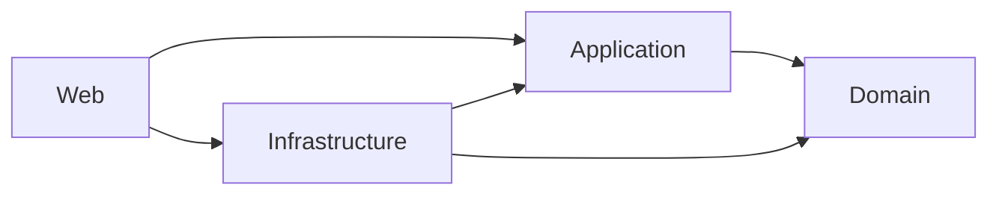
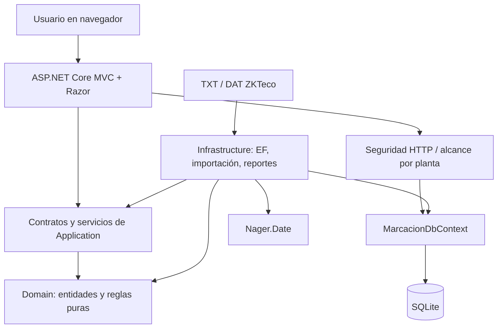
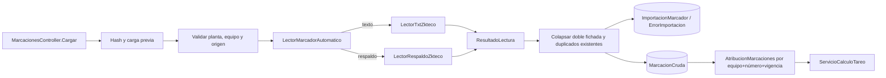
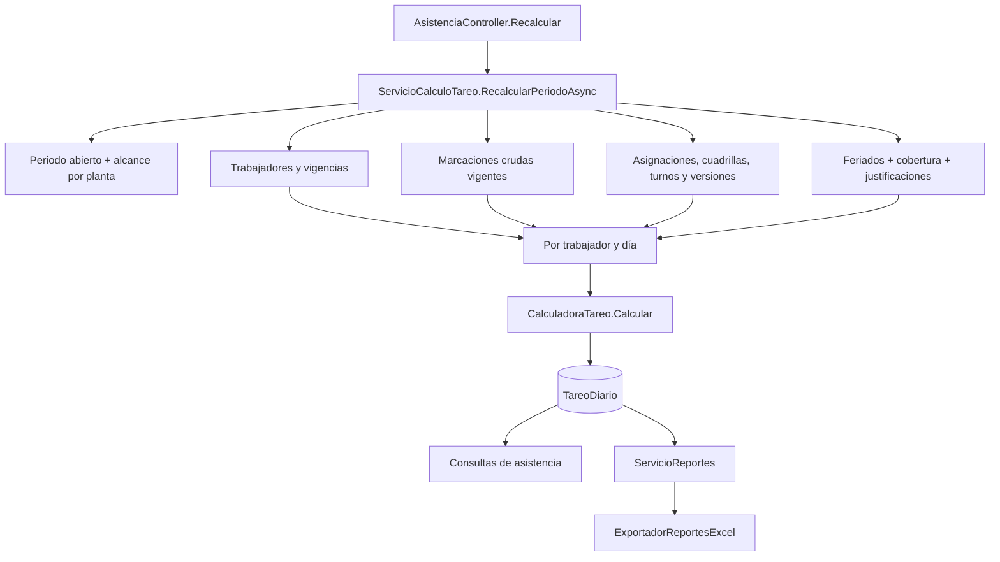

# Ingeniería inversa — primera ejecución

Fecha de corte: 2026-09-29  
Alcance: pasos 1 a 10 del prompt maestro; sin refactorización ni cambios funcionales.  
Estado: **PRELIMINAR**. Las afirmaciones usan `[CONFIRMADO]`, `[INFERIDO]` y `[NO DETERMINADO]`.

## Resumen ejecutivo

`[CONFIRMADO]` La solución es una aplicación de escritorio operacional servida como web local: ASP.NET Core MVC/Razor sobre .NET 10, EF Core 10 y SQLite. El proceso abre el navegador, escucha en un puerto local y en producción guarda la base en una ruta configurable o bajo `ProgramData`.

`[CONFIRMADO]` La estructura de proyectos sigue una separación Domain → Application → Infrastructure → Web, sin ciclos entre proyectos. La dirección real de referencias es:

`[CONFIRMADO]` El núcleo de negocio no es un simple CRUD. La atribución de marcaciones se resuelve por aparato, número y vigencia; el turno puede proceder de una asignación directa o de una rotación por cuadrilla; el cálculo considera versiones históricas del horario, cobertura de archivos, feriados, justificaciones y jornadas que cruzan medianoche.

`[CONFIRMADO]` El recorrido principal observado es: archivo ZKTeco → detección texto/respaldo binario → lectura → validación de origen/equipo → deduplicación → `ImportacionMarcador` y `MarcacionCruda` → atribución por vigencia durante el recálculo → `CalculadoraTareo` → `TareoDiario` → consultas y exportación Excel.

`[CONFIRMADO]` Hay pruebas unitarias e integración relevantes, pero en esta fase no se ejecutaron ni se evaluó todavía cobertura de reglas. Tampoco se midió performance ni se inspeccionó el modelo físico completo.

`[CONFIRMADO]` El repositorio ya estaba ampliamente modificado antes de esta auditoría. Esas modificaciones se preservaron. Esta fase solo añade documentación bajo `docs/reverse-engineering/`.

## 1. Inventario estructural

Se excluyeron de la lectura de código `bin/`, `obj/`, `.git/`, binarios publicados, respaldos y artefactos comprimidos. Los conteos son inventario, no una afirmación de calidad.

### Raíz

| Carpeta | Responsabilidad aparente | Archivos inventariados | Tamaño aprox. | Importancia |
|---|---|---:|---:|---|
| `src/` | Código productivo y base SQLite de desarrollo | 304 | 7.2 MB | CRÍTICO |
| `tests/` | Pruebas unitarias y de integración | 68 | 0.7 MB | ALTO |
| `docs/` | Requisitos, arquitectura previa, formatos, despliegue, ADR y manuales | 11 antes de esta fase | 0.6 MB | ALTO |
| `despliegue/` | Publicación, ejecutables, ZIP/RAR y respaldos de BD | 69 | 167 MB | MEDIO para operación; BAJO para lectura habitual |
| `tools/` | Generador de `attlog` y scripts de publicación/instalación | 5 | 36 KB | MEDIO |
| `.claude/` | Configuración e instrucciones auxiliares de agentes | 13 | 51 KB | BAJO para comportamiento en ejecución |

### Solución y proyectos

| Proyecto/carpeta | Responsabilidad real preliminar | Archivos | Líneas C# aprox. sin migraciones generadas | Dependencias de proyecto | Importancia |
|---|---|---:|---:|---|---|
| `ControlMarcacion.Domain` | Entidades, vigencias y reglas puras de tareo, cobertura y atribución | 49 | 4,453 | ninguna | CRÍTICO |
| `ControlMarcacion.Application` | Contratos, DTO, casos de uso y orquestación sin EF | 51 | 5,268 | Domain | CRÍTICO |
| `ControlMarcacion.Infrastructure` | EF Core, SQLite, servicios, consultas, importadores, seguridad y Excel | 67 no generados | 17,103 | Application, Domain | CRÍTICO |
| `ControlMarcacion.Web` | MVC, Razor, modelos de vista, seguridad HTTP y composición | 123 | 4,892 C# | Application, Infrastructure | CRÍTICO |
| `ControlMarcacion.Domain.Tests` | Pruebas puras de reglas y servicios sin BD | 21 | 4,514 | Domain, Application | ALTO |
| `ControlMarcacion.Infrastructure.Tests` | Pruebas con EF InMemory/SQLite, importación y reportes | 47 | 8,848 | Infrastructure | ALTO |

Notas:

- `[CONFIRMADO]` Infrastructure contiene además 13 migraciones posteriores al esquema inicial, sus `Designer.cs` y el snapshot. Estos generados dominan el conteo bruto de líneas, pero no deben cargarse como contexto habitual.
- `[CONFIRMADO]` Web contiene 20 controladores, 22 modelos de vista, 57 vistas y 14 activos web inventariados.
- `[CONFIRMADO]` Infrastructure registra 28 servicios/dependencias en su composición.

## 2. Stack tecnológico real

| Área | Tecnología encontrada | Estado/evidencia |
|---|---|---|
| Runtime | .NET 10 (`net10.0`), C# `latest`, nullable e implicit usings | `[CONFIRMADO]` `Directory.Build.props` |
| Aplicación | ASP.NET Core MVC con vistas Razor | `[CONFIRMADO]` SDK Web, `AddControllersWithViews`, controllers y `.cshtml` |
| Frontend | HTML/Razor, CSS y JavaScript propio; sin `package.json` ni framework SPA encontrado | `[CONFIRMADO]` inventario de Web |
| Persistencia | Entity Framework Core 10.0.10 | `[CONFIRMADO]` paquetes y `MarcacionDbContext` |
| Base de datos | SQLite local | `[CONFIRMADO]` `UseSqlite`, archivos `.db/.wal/.shm` |
| Autenticación | ASP.NET Core Identity con cookie | `[CONFIRMADO]` `AddIdentity` y `IdentityDbContext<ApplicationUser>` |
| Autorización | Filtro global autenticado + roles `COORDINADOR`, `ADMINISTRADOR`, `GERENCIA`, `TRABAJADOR_SOCIAL` | `[CONFIRMADO]` Program y `RolesSistema` |
| Aislamiento | Alcance por planta para ADMINISTRADOR | `[CONFIRMADO]` `ProveedorAlcancePlantasHttp` |
| Logging | `Microsoft.Extensions.Logging`; niveles configurados en `appsettings.json` | `[CONFIRMADO]`; mapa completo pendiente |
| Reportes | ClosedXML 0.105.1; salida Excel | `[CONFIRMADO]` paquete y `ExportadorReportesExcel` |
| Archivos ZKTeco | TXT tabulado y respaldo binario `BKtransaction.dat`, autodetectados por contenido | `[CONFIRMADO]` lectores de Infrastructure |
| Integración externa | Nager.Date vía `HttpClient`, sincronización manual de feriados | `[CONFIRMADO]` DI y proveedor |
| Serialización | `System.Text.Json` para auditoría/integración | `[CONFIRMADO]` referencias de código |
| Caché | No se encontró caché de aplicación | `[CONFIRMADO]` búsqueda estática inicial |
| Jobs/background | No se encontró `BackgroundService`, `IHostedService` ni job interno | `[CONFIRMADO]` búsqueda estática inicial |
| Testing | xUnit 2.9.3, Shouldly 4.3.0, NSubstitute 6.0.0, EF InMemory y SQLite, coverlet | `[CONFIRMADO]` proyectos de prueba |
| Despliegue | Windows, Kestrel local, navegador predeterminado, scripts PowerShell y artefacto publicado | `[CONFIRMADO]` Program e inventario |

No se encontró una conexión directa mediante SDK/API de ZKTeco. La integración observada es por archivos.

## 3. Proyectos, capas y dirección de dependencias

### Arquitectura real preliminar

Hallazgos:

- `[CONFIRMADO]` Domain no referencia otros proyectos ni namespaces Web/Infrastructure.
- `[CONFIRMADO]` Application referencia Domain y abstractions de DI/logging; no se encontró EF Core.
- `[CONFIRMADO]` Infrastructure implementa contratos de Application y accede a Domain/EF.
- `[CONFIRMADO]` Web es composition root y referencia Application e Infrastructure.
- `[CONFIRMADO]` Existe acceso directo de Web a `MarcacionDbContext` en `ProveedorAlcancePlantasHttp`, además del uso de contexto en el arranque/Identity. Es una excepción real a la narración de “cero acceso directo al DbContext” del `.csproj`; se evaluará si está justificada o es deuda.
- `[NO DETERMINADO]` Aún no se evaluaron dependencias entre módulos a nivel de método ni posibles ciclos lógicos dentro de Application/Infrastructure.

## 4. Mapa preliminar de módulos

| Módulo funcional | Implementación encontrada | Estado | Responsabilidad preliminar |
|---|---|---|---|
| Organización | `Cliente`, `Empresa`, `Planta`, `Area`, `Seccion`, `Centro`, `CentroCosto` | ENCONTRADO | Estructura organizativa y contable |
| Personal | `Trabajador`, vigencias de marcador/turno/área/sueldo y `PeriodoLaboral` | ENCONTRADO | Padrón e históricos laborales |
| Aparatos/marcadores | `EquipoMarcador`, `Marcador`, `AsignacionMarcador` | DISTRIBUIDO | Aparato físico, número/catálogo y atribución por vigencia; semántica exacta de `Marcador` pendiente |
| Marcaciones | `ImportacionMarcador`, `MarcacionCruda`, `ErrorImportacion`, lectores y `ServicioImportacion` | ENCONTRADO | Ingesta inmutable, trazabilidad, cobertura y deduplicación |
| Turnos/horarios | `Turno`, `VersionTurno`, `TurnoPlanta`, `AsignacionTurno` | DISTRIBUIDO | Turno, horario histórico, habilitación y asignación |
| Rotación | `Cuadrilla`, `ProgramacionCuadrilla`, `TramoRotacion` | ENCONTRADO | Ciclos de turnos por cuadrilla |
| Jornada/asistencia | `EntradaCalculo`, `ResultadoCalculo`, `CalculadoraTareo` | DISTRIBUIDO | Jornada derivada y reglas puras; no se observó entidad `Jornada` persistida |
| Tareo | `TareoDiario`, `ServicioCalculoTareo` | ENCONTRADO | Resultado diario persistido y consultas/resumen/liquidación |
| Incidencias | `TipoIncidencia` y campos de `TareoDiario`; `IncidenciasController` | ENCONTRADO | Atributo calculado del día, no entidad separada |
| Solicitudes | `SolicitudAusencia`, `ServicioSolicitudes` | ENCONTRADO | Flujo de ausencia y sustento |
| Justificaciones | `Justificacion`, `ServicioJustificaciones` | ENCONTRADO | Correcciones/aprobaciones que alimentan el recálculo |
| Reintegros | `ReintegroTareo`, `ServicioReintegrosTareo` | ENCONTRADO | Ajustes asociados al periodo/tareo final |
| Feriados/normativa | `Feriado`, `ParametroLegal`, `TasaSobretasa`, proveedor Nager.Date | ENCONTRADO | Calendario y parámetros históricos de cálculo |
| Reportes | `ServicioReportes`, DTO y `ExportadorReportesExcel` | ENCONTRADO | Resumen, excepciones y tareo final |
| Seguridad | Identity, roles, `UsuarioPlanta`, proveedores HTTP | ENCONTRADO | Identidad, permisos y alcance de datos |
| Auditoría | `RegistroAuditoria`, `InterceptorAuditoria`, `ConsultaAuditoria` | ENCONTRADO | Bitácora automática de cambios |
| Inicio | `ServicioPanelInicio`, `InicioController` | ENCONTRADO | Agregación del panel principal |

## 5. Puntos de entrada

| Entrada | Componente | Comportamiento |
|---|---|---|
| Proceso | `ControlMarcacion.Web/Program.cs` | Configura puerto, DI, MVC, Identity, migraciones/siembra y arranca Kestrel |
| Ruta MVC | `{controller=Inicio}/{action=Index}/{id?}` | Entrada web predeterminada |
| Salud/identidad | `GET /estado` | Marca anónima para detectar una instancia ya activa |
| Importación | `MarcacionesController.Cargar` | Recibe archivo y planta/equipo, valida tamaño y delega |
| Recálculo | `AsistenciaController.Recalcular` | Dispara el cálculo de un periodo abierto |
| Reportes | `ReportesController` | Consulta y exporta resumen, excepciones y tareo final |
| Administración | 17 controladores adicionales | Personal, catálogos, turnos, cuadrillas, equipos, periodos, solicitudes, etc. |
| Archivo externo | `LectorMarcadorAutomatico.Leer` | Decide lector por contenido, no por extensión |
| Integración HTTP | `ProveedorFeriadosNagerDate` | Obtiene feriados para sincronización manual |
| Instalación | `tools/despliegue/*.ps1` | Publicación/instalación en Windows; análisis detallado pendiente |

## 6. Flujo preliminar de marcaciones

| Etapa | Clase/método | Entrada | Salida/BD | Riesgo preliminar |
|---|---|---|---|---|
| HTTP | `MarcacionesController.Cargar` | `IFormFile`, planta, equipo | `MemoryStream`; resultado/redirect | Archivo completo en memoria; límite confirmado de 20 MB |
| Carga previa | `BuscarImportacionPreviaAsync` | stream | consulta por hash | Relectura deliberada del stream |
| Detección | `LectorMarcadorAutomatico.Leer` | stream | selección texto/binario | Flujo no seekable cae por diseño a texto |
| Parsing | `LectorTxtZkteco` / `LectorRespaldoZkteco` | bytes | `ResultadoLectura` | Formatos reales y codificación requieren pruebas de corpus |
| Origen | `ServicioImportacion.ImportarAsync` | serie/nombre/hash/equipo | origen verificado o rechazo | Regla crítica para evitar atribuir dos veces a personas distintas |
| Dedupe | `ColapsarDobleFichada`, `ContarYaExistentesAsync` | marcas leídas | nuevas/duplicadas | Complejidad y límites SQL por lotes pendientes de auditoría |
| Persistencia | `ImportacionMarcador`, `ErrorImportacion`, `MarcacionCruda` | nuevas y errores | SQLite | El bucle `AddAsync` no demuestra N+1: hay un único `SaveChangesAsync` posterior; sí puede implicar tracking/memoria a gran escala |
| Atribución | `AtribucionMarcaciones` durante recálculo | equipo+número+fecha | trabajador | La marcación no fija trabajador al importar; correcciones de vigencia requieren recalcular |
| Cobertura | `AparatosSinCargaAsync` | rango | faltantes por día/aparato | Distingue falta de dato de falta laboral |

## 7. Flujo preliminar de tareo

| Etapa | Implementación | Hallazgo |
|---|---|---|
| Selección | `AsistenciaController.Recalcular` | Usuario solicita periodo; controlador delega |
| Protección | `ServicioCalculoTareo` | Rechaza periodo cerrado y aplica alcance por planta |
| Precarga | EF Core en `ServicioCalculoTareo` | Trabajadores, vigencias, marcas, turnos, versiones, feriados, tareos existentes y justificaciones se cargan antes del bucle principal |
| Atribución | `AtribucionMarcaciones` | Resuelve propietario por aparato+número+vigencia en la fecha de marca |
| Turno | `ResolverTurno` | Combina asignación directa/cuadrilla y versión histórica; detalle completo pendiente |
| Jornada | `MarcacionesDeLaJornada` | Selecciona ventana y protege el arrastre nocturno del día previo |
| Regla pura | `CalculadoraTareo.Calcular` | Calcula estados, tardanza, salida anticipada, extras, nocturnidad, descansos/feriados y justificación |
| Persistencia | `TareoDiario` | Upsert en memoria por `(TrabajadorId, Fecha)` y un `SaveChangesAsync`; recálculo idempotente declarado |
| Concurrencia | `AfirmarAbierto(periodo)` | Verifica versión al guardar para no escribir sobre periodo cerrado concurrentemente |
| Consumo | `ServicioReportes` | Lee tareo persistido; reportes no recalculan |
| Exportación | `ExportadorReportesExcel` | Genera resumen, excepciones y libro final multihoja |

`[INFERIDO]` La arquitectura busca separar adquisición cruda, atribución temporal y cálculo derivado. Esto favorece correcciones históricas sin reescribir el dato fuente, pero aumenta la cantidad de archivos que una IA debe comprender para cambios transversales.

## 8. Lista inicial de hotspots

No se declara todavía ninguna “god class”; hace falta medir cohesión, consumidores y cambio histórico. La lista solo prioriza la siguiente lectura.

| # | Componente | Evidencia estática | Motivo de prioridad |
|---:|---|---|---|
| 1 | `ServicioReportes.cs` | 1,197 líneas, 22 métodos, 29 terminales EF aprox. | Tres familias de reporte, rangos, metadatos, vigencias, normas y resolución de trabajadores |
| 2 | `ServicioCalculoTareo.cs` | 1,032 líneas, 22 métodos, 22 terminales EF | Orquestación crítica, múltiples fuentes y bucle trabajador×día |
| 3 | `CalculoTareo.cs` | 1,037 líneas, 25 métodos | Fuente central de reglas laborales; alto impacto de regresión |
| 4 | `ServicioImportacion.cs` | 955 líneas, 23 métodos, 27 terminales EF, 8 bucles | Mezcla importación, origen, dedupe, historial, cobertura y diagnósticos |
| 5 | `ServicioTrabajadores.cs` | 1,058 líneas, 26 métodos, 6 dependencias de constructor | Superficie amplia de personal y vigencias |
| 6 | `ExportadorReportesExcel.cs` | 816 líneas, 22 métodos, 28 bucles | Layout Excel final, agregación y alto costo potencial en memoria |
| 7 | `ServicioSolicitudes.cs` | 581 líneas, 19 métodos, 19 terminales EF | Flujo de estados y relación con justificaciones |
| 8 | `ServicioJustificaciones.cs` | 573 líneas, 12 métodos, 22 terminales EF | Modifica insumos que alteran el tareo; consistencia crítica |
| 9 | `ConsultaTrabajadores.cs` | 565 líneas, 9 métodos, 13 terminales EF | Varias proyecciones complejas y datos históricos |
| 10 | `DatosSemilla.cs` | 618 líneas | Estado inicial, roles, catálogos y parámetros que condicionan comportamiento |

Hotspots de contexto, separados de performance en ejecución:

- `Migraciones/*.Designer.cs` y `MarcacionDbContextModelSnapshot.cs`: decenas de miles de líneas generadas; leer solo para preguntas de esquema histórico concretas.
- `despliegue/`: 167 MB entre publicación, comprimidos y respaldos; excluir del contexto normal.
- `CLAUDE.md`: 93 KB y modificado; puede orientar agentes, pero no es evidencia del comportamiento del ejecutable.
- Comentarios XML extensos: ayudan a entender intención, pero deben contrastarse con código y pruebas.

## 9. Plan de ingeniería inversa

### Fase 2 — Dominio y arquitectura detallada

- Completar equivalencias funcional/técnicas.
- Trazar dependencias módulo a módulo y consumidores.
- Verificar responsabilidades de controllers, Application, Infrastructure y Domain.
- Crear diagramas D01–D05 y D13 preliminares.

### Fase 3 — Base de datos y consultas

- Construir modelo lógico/físico desde configuraciones EF y SQLite objetivo.
- Inventariar PK, FK, índices, únicos, nulabilidad y constraints.
- Crear ERD y matriz CRUD.
- Auditar materialización, tracking, consultas correlacionadas, bucles, `Include` y planes SQLite.

### Fase 4 — Flujos, linaje y reglas

- Completar marcación → jornada → tareo → reporte con métodos y campos.
- Reconstruir turnos/rotación, solicitudes, justificaciones, reintegros y reportes.
- Crear catálogo de reglas y matriz reglas×módulos.
- Resolver “de dónde sale cada número” del tareo final.

### Fase 5 — Calidad operativa

- Auditar errores/logging, seguridad, hardcodes, duplicación y código potencialmente muerto.
- Mapear cobertura funcional de pruebas y huecos de caracterización.
- Diseñar baseline reproducible de 1,000/20,000 marcas y periodos diarios/mensuales; no optimizar antes de medir.

### Fase 6 — Dossier y plan de intervención

- Consolidar `MASTER_DOSSIER`, `ARCHITECTURE`, `DATABASE`, `BUSINESS_RULES`, `TECHNICAL_DEBT` y documentos por módulo.
- Publicar diagramas D01–D13, matrices, top 10 definitivo y planes P0–P3.
- Crear `AI_CONTEXT_MAP.md` con rutas mínimas por tipo de cambio.
- Solo después: tests de caracterización, refactors pequeños y medición antes/después.

## 10. Dudas que requieren información humana

No hay una pregunta bloqueante para continuar la ingeniería inversa estática. Antes de auditar datos físicos y performance sí harán falta respuestas agrupadas:

1. **Base representativa**: ¿cuál archivo SQLite debe considerarse copia canónica o representativa de producción? El repositorio contiene bases en Web y varios respaldos de despliegue; elegir una por fecha sería una suposición peligrosa.
2. **Uso de datos**: ¿se autoriza analizar localmente esa copia con datos personales, o debe entregarse una versión anonimizada? No se extraerán ni publicarán PII en la documentación.
3. **Oráculo funcional**: ¿qué periodo cerrado y qué archivo de tareo aceptado por planillas deben usarse como resultado de referencia para validar el linaje y los tests de caracterización?
4. **Baseline operativo**: hardware objetivo, volumen máximo real de trabajadores/marcaciones y tiempo aceptable para importación, recálculo y exportación.

Estas respuestas pueden esperar hasta las fases de BD/performance; no interrumpen la siguiente lectura de código.

## Control de la fase

**FASE:** primera ejecución — descubrimiento estructural y flujos preliminares.  
**Archivos revisados:** solución/proyectos, arranque/DI/contexto, contratos y entradas de marcaciones/tareo, lectores ZKTeco, seguridad por roles/plantas y entrada de reportes; detalle en `CONTEXT_REGISTER.md`.  
**Hallazgos:** stack y capas confirmados; flujo crudo→atribución→tareo confirmado; ausencia inicial de jobs/caché; hotspots priorizados.  
**Evidencias:** rutas y métodos citados en cada sección; métricas obtenidas excluyendo generados.  
**Dudas:** base canónica, política de datos, oráculo funcional y baseline operativo.  
**Riesgos:** comentarios/documentación pueden expresar intención y no conducta; BD, reglas y queries aún no están completamente auditadas.  
**Documentación generada:** este informe y `CONTEXT_REGISTER.md`.  
**Siguiente fase:** dominio y arquitectura detallada, sin refactorizar.

## Cobertura de comprensión actual

**Estimación global: 35 %.**

- Arquitectura de proyectos, stack y entradas principales: aproximadamente 65 %.
- Importación y recálculo de tareo a nivel de flujo: aproximadamente 50 %.
- Reglas laborales detalladas, modelo físico, solicitudes/justificaciones/reintegros, reportes, seguridad completa, observabilidad y deployment: entre 10 % y 30 % según módulo.
- Performance real: 0 % medido; solo hay hipótesis estáticas explícitamente marcadas.

El 35 % expresa cuánto puede explicarse hoy sin volver a recorrer todo el repositorio. Para llegar al nivel “dossier maestro + documento del módulo + archivos estrictamente necesarios” faltan: contratos y dependencias por módulo, catálogo de reglas con evidencia, modelo físico/ERD, linaje campo a campo del tareo final, mapas de consultas, cobertura de pruebas, decisiones de seguridad/operación, diagramas estables y un índice de contexto validado por tareas reales.
