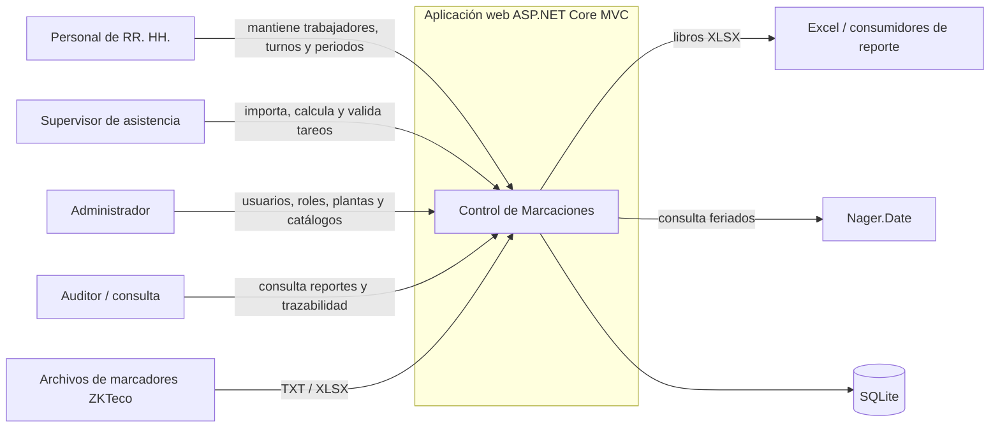

# D01 — Contexto del sistema

Notas:

- La importación es por archivos; no se confirmó integración en línea con los equipos.
- Autenticación, roles y alcance por planta forman parte de la misma aplicación.
- Los reportes son proyecciones derivadas; no existe una entidad persistida `Reporte`.
