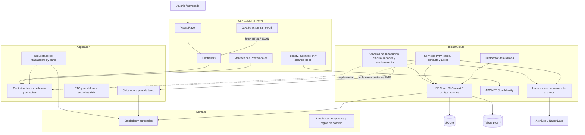

# D02 — Capas y contenedores lógicos

La dirección entre proyectos es acíclica. No obstante, las responsabilidades de casos de uso se reparten entre `Application` e `Infrastructure`; el diagrama representa la arquitectura observada, no una arquitectura limpia idealizada.
