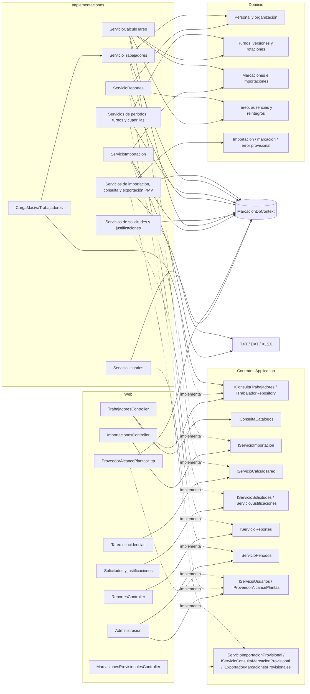

# D03 — Componentes del backend

Las flechas muestran dependencias funcionales efectivas. En particular, cálculo y reportes atraviesan varios módulos mediante consultas directas al contexto de datos. PMV comparte lectores y `DbContext`, pero persiste solo en `prov_*`; su consulta lee padrón, organización y turnos sin escribirlos.
