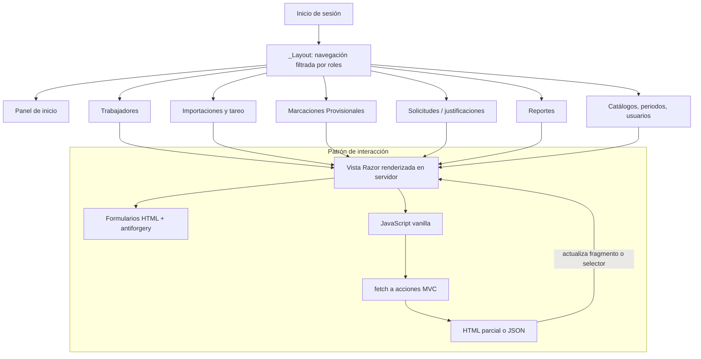

# D04 — Navegación y composición del frontend

No se observó SPA, almacén de estado cliente ni una capa separada de cliente API. La autorización se aplica en el servidor; la navegación visible por rol es una ayuda de interfaz, no la frontera de seguridad. PMV usa formularios Razor para carga/consulta y una descarga XLSX; el controller exige Coordinador o Administrador.
