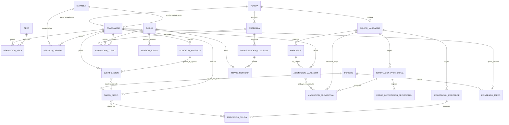

# D05 — Modelo de dominio conceptual

Precisiones:

- `Jornada` no es una entidad persistida; es un concepto calculado alrededor de trabajador, fecha, turno resuelto, ventana y marcaciones.
- La relación visual entre `TareoDiario` y `MarcacionCruda` es conceptual: el resultado guarda horas de entrada/salida, no una tabla puente de trazabilidad a cada marca.
- La pertenencia histórica a planta no tiene una entidad equivalente a `AsignacionArea` en el modelo observado.
- `MarcacionProvisional` no guarda trabajador: la relación con `AsignacionMarcador` es conceptual y se resuelve por equipo, ID y fecha durante la consulta.
- Las tres entidades provisionales son una rama separada y no alimentan `MarcacionCruda` ni `TareoDiario`.
