# D06 — ERD físico de SQLite / EF Core

Este diagrama contiene únicamente relaciones FK confirmadas por el modelo EF y el snapshot. Una columna con sufijo _id sin flecha no tiene restricción FK física.

```mermaid
erDiagram
    CLIENTE {
        long id PK
        string codigo UK
    }
    EMPRESA {
        long id PK
        long cliente_id FK
        string codigo UK
        string ruc UK
    }
    PLANTA {
        long id PK
        long empresa_id FK
        string codigo
    }
    AREA {
        long id PK
        long planta_id FK
        string codigo
    }
    SECCION {
        long id PK
        long area_id FK
        string codigo
    }
    CENTRO {
        long id PK
        long empresa_id FK
        long planta_id FK "opcional"
        string codigo
    }
    CENTRO_COSTO {
        long id PK
        long centro_id FK
        string codigo
    }
    TRABAJADOR {
        long id PK
        long empresa_id "sin FK"
        long planta_id "sin FK"
        long area_id "opcional sin FK"
        long seccion_id "opcional sin FK"
        long centro_costo_id "opcional sin FK"
        date fecha_ingreso
        date fecha_cese "opcional"
    }
    PERIODO_LABORAL {
        long id PK
        long trabajador_id FK
        long empresa_id FK
        date fecha_ingreso
        date fecha_cese "opcional"
    }
    ASIGNACION_MARCADOR {
        long id PK
        long trabajador_id FK
        long equipo_id FK
        string id_marcador
        date fecha_inicio
        date fecha_fin "opcional"
    }
    ASIGNACION_AREA {
        long id PK
        long trabajador_id FK
        long area_id FK
        date fecha_inicio
        date fecha_fin "opcional"
    }
    ASIGNACION_TURNO {
        long id PK
        long trabajador_id FK
        long turno_id FK "XOR opcional"
        long cuadrilla_id FK "XOR opcional"
        date fecha_inicio
        date fecha_fin "opcional"
    }
    ASIGNACION_SUELDO {
        long id PK
        long trabajador_id FK
        decimal sueldo_basico_mensual
        date fecha_inicio
        date fecha_fin "opcional"
    }
    EQUIPO_MARCADOR {
        long id PK
        long planta_id FK
        string codigo UK
        string serie UK "opcional filtrado"
    }
    MARCADOR {
        long id PK
        long equipo_id FK
        long planta_id FK
        string codigo
    }
    IMPORTACION_MARCADOR {
        long id PK
        long equipo_id FK
        string hash_contenido
        bool anulada
    }
    ERROR_IMPORTACION {
        long id PK
        long importacion_id FK
    }
    MARCACION_CRUDA {
        long id PK
        long equipo_id FK
        long importacion_id FK
        string id_marcador
        datetime fecha_hora
    }
    PROV_IMPORTACION {
        long id PK
        long equipo_id FK
        string hash_contenido "índice no único"
        datetime fecha_carga
        int filas_leidas
        int filas_insertadas
        int filas_rechazadas
    }
    PROV_MARCACION {
        long id PK
        long equipo_id FK
        long importacion_provisional_id FK
        string id_marcador
        datetime fecha_hora
    }
    PROV_ERROR_IMPORTACION {
        long id PK
        long importacion_provisional_id FK
        int numero_linea
        string motivo
    }
    TURNO {
        long id PK
        string codigo UK
    }
    VERSION_TURNO {
        long id PK
        long turno_id FK
        date fecha_inicio
        date fecha_fin "opcional"
    }
    TURNO_PLANTA {
        long id PK
        long turno_id FK
        long planta_id FK
    }
    CUADRILLA {
        long id PK
        long planta_id FK
        string codigo
    }
    PROGRAMACION_CUADRILLA {
        long id PK
        long cuadrilla_id FK
        date fecha_inicio
        date fecha_fin "opcional"
        date fecha_ancla
    }
    TRAMO_ROTACION {
        long id PK
        long programacion_id FK
        long turno_id FK
        int orden
        int dias
    }
    TIPO_AUSENCIA {
        long id PK
        string codigo UK
    }
    SOLICITUD_AUSENCIA {
        long id PK
        long trabajador_id "sin FK"
        long tipo_ausencia_id FK
    }
    JUSTIFICACION {
        long id PK
        long trabajador_id "sin FK"
        long periodo_id "sin FK"
        long solicitud_ausencia_id FK "opcional"
        long tipo_ausencia_id "opcional sin FK"
        int version "concurrencia"
    }
    PERIODO {
        long id PK
        string codigo UK
        int version "concurrencia"
    }
    TAREO_DIARIO {
        long id PK
        long periodo_id "sin FK"
        long trabajador_id "sin FK"
        long turno_id "opcional sin FK"
        long justificacion_id "opcional sin FK"
        date fecha
    }
    REINTEGRO_TAREO {
        long id PK
        long periodo_id "sin FK"
        long trabajador_id "sin FK"
    }
    TIPO_DOCUMENTO {
        long id PK
        string codigo UK
    }
    PUESTO {
        long id PK
        long empresa_id "opcional sin FK"
        string codigo UK
    }
    FERIADO {
        long id PK
        long planta_id "opcional sin FK"
        date fecha
    }
    PARAMETRO_LEGAL {
        long id PK
        string tipo
        date vigente_desde
        date vigente_hasta "opcional"
    }
    TASA_SOBRETASA {
        long id PK
        long empresa_id "opcional sin FK"
        string concepto
        date vigente_desde
        date vigente_hasta "opcional"
    }
    REGISTRO_AUDITORIA {
        long id PK
        string tabla
        string clave_registro
        datetime fecha_hora
    }
    ASP_NET_USERS {
        string id PK
        string normalized_user_name UK
    }
    ASP_NET_ROLES {
        string id PK
        string normalized_name UK
    }
    ASP_NET_ROLE_CLAIMS {
        int id PK
        string role_id FK
    }
    ASP_NET_USER_CLAIMS {
        int id PK
        string user_id FK
    }
    ASP_NET_USER_LOGINS {
        string login_provider PK
        string provider_key PK
        string user_id FK
    }
    ASP_NET_USER_ROLES {
        string user_id PK, FK
        string role_id PK, FK
    }
    ASP_NET_USER_TOKENS {
        string user_id PK, FK
        string login_provider PK
        string name PK
    }
    USUARIO_PLANTA {
        string usuario_id PK, FK
        long planta_id PK, FK
    }

    CLIENTE ||--o{ EMPRESA : "fk empresa.cliente_id"
    EMPRESA ||--o{ PLANTA : "fk planta.empresa_id"
    PLANTA ||--o{ AREA : "fk area.planta_id"
    AREA ||--o{ SECCION : "fk seccion.area_id"
    EMPRESA ||--o{ CENTRO : "fk centro.empresa_id"
    PLANTA o|--o{ CENTRO : "fk opcional centro.planta_id"
    CENTRO ||--o{ CENTRO_COSTO : "fk centro_costo.centro_id"
    TRABAJADOR ||--o{ PERIODO_LABORAL : "cascade"
    EMPRESA ||--o{ PERIODO_LABORAL : "restrict"
    TRABAJADOR ||--o{ ASIGNACION_MARCADOR : "cascade"
    EQUIPO_MARCADOR ||--o{ ASIGNACION_MARCADOR : "restrict"
    TRABAJADOR ||--o{ ASIGNACION_AREA : "cascade"
    AREA ||--o{ ASIGNACION_AREA : "restrict"
    TRABAJADOR ||--o{ ASIGNACION_TURNO : "cascade"
    TURNO o|--o{ ASIGNACION_TURNO : "restrict, XOR"
    CUADRILLA o|--o{ ASIGNACION_TURNO : "restrict, XOR"
    TRABAJADOR ||--o{ ASIGNACION_SUELDO : "cascade"
    PLANTA ||--o{ EQUIPO_MARCADOR : "restrict"
    EQUIPO_MARCADOR ||--o{ MARCADOR : "restrict"
    PLANTA ||--o{ MARCADOR : "restrict"
    EQUIPO_MARCADOR ||--o{ IMPORTACION_MARCADOR : "restrict"
    IMPORTACION_MARCADOR ||--o{ ERROR_IMPORTACION : "cascade"
    IMPORTACION_MARCADOR ||--o{ MARCACION_CRUDA : "restrict"
    EQUIPO_MARCADOR ||--o{ MARCACION_CRUDA : "restrict"
    EQUIPO_MARCADOR ||--o{ PROV_IMPORTACION : "restrict"
    EQUIPO_MARCADOR ||--o{ PROV_MARCACION : "restrict"
    PROV_IMPORTACION ||--o{ PROV_MARCACION : "restrict"
    PROV_IMPORTACION ||--o{ PROV_ERROR_IMPORTACION : "cascade"
    TURNO ||--o{ VERSION_TURNO : "cascade"
    TURNO ||--o{ TURNO_PLANTA : "cascade"
    PLANTA ||--o{ TURNO_PLANTA : "restrict"
    PLANTA ||--o{ CUADRILLA : "restrict"
    CUADRILLA ||--o{ PROGRAMACION_CUADRILLA : "restrict"
    PROGRAMACION_CUADRILLA ||--o{ TRAMO_ROTACION : "restrict"
    TURNO ||--o{ TRAMO_ROTACION : "restrict"
    TIPO_AUSENCIA ||--o{ SOLICITUD_AUSENCIA : "restrict"
    SOLICITUD_AUSENCIA o|--o{ JUSTIFICACION : "restrict"
    ASP_NET_ROLES ||--o{ ASP_NET_ROLE_CLAIMS : "cascade"
    ASP_NET_USERS ||--o{ ASP_NET_USER_CLAIMS : "cascade"
    ASP_NET_USERS ||--o{ ASP_NET_USER_LOGINS : "cascade"
    ASP_NET_USERS ||--o{ ASP_NET_USER_ROLES : "cascade"
    ASP_NET_ROLES ||--o{ ASP_NET_USER_ROLES : "cascade"
    ASP_NET_USERS ||--o{ ASP_NET_USER_TOKENS : "cascade"
    ASP_NET_USERS ||--o{ USUARIO_PLANTA : "cascade"
    PLANTA ||--o{ USUARIO_PLANTA : "restrict"
```

Notas físicas:

- TareoDiario no tiene relación FK con MarcacionCruda ni tabla puente de marcas consumidas.
- Los IDs organizativos de Trabajador no tienen FK.
- Justificacion, SolicitudAusencia, ReintegroTareo y TareoDiario conservan varios IDs de negocio sin FK.
- La obligatoriedad XOR de AsignacionTurno está reforzada por un check constraint.
- Las tablas provisionales no tienen FK a trabajador ni relaciones físicas con marcación cruda o tareo; `PROV_MARCACION` es única por equipo, ID e instante.
