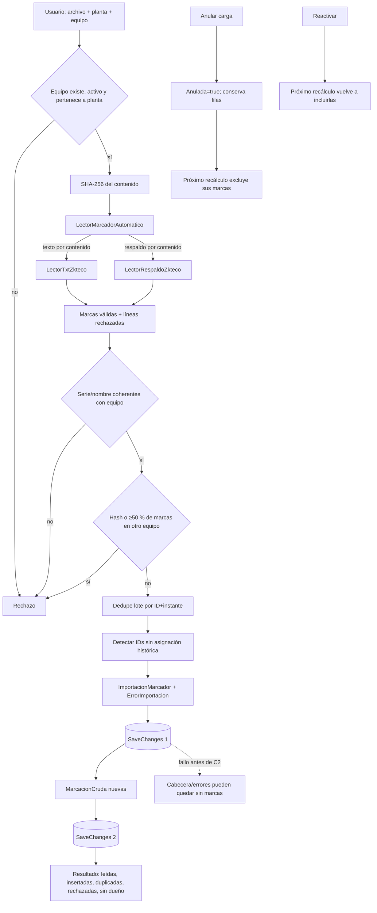

# D07 — Flujo de importación ZKTeco principal

Notas:

- La base protege `(equipo, ID, instante)`; el hash no es unique físico.
- ID sin dueño no es fila rechazada: la marca queda disponible para una asignación posterior.
- Anular/reactivar no recalcula automáticamente.

