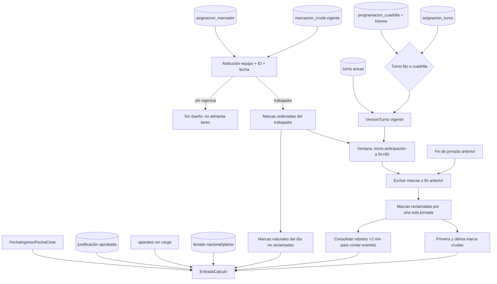

# D08 — De marcación cruda a jornada candidata

Una jornada nocturna pertenece a su fecha de inicio. La primera/última marca y el margen de seis horas son reglas implementadas, no hechos confirmados por negocio.

