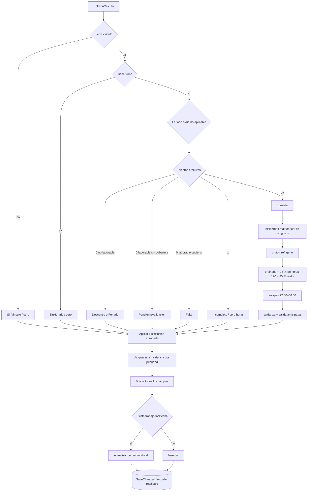

# D09 — De jornada candidata a `TareoDiario`

El estado y la incidencia son dimensiones distintas. Un día puntual puede requerir validación por turno discrepante; un incompleto justificado puede dejar de requerirla.

