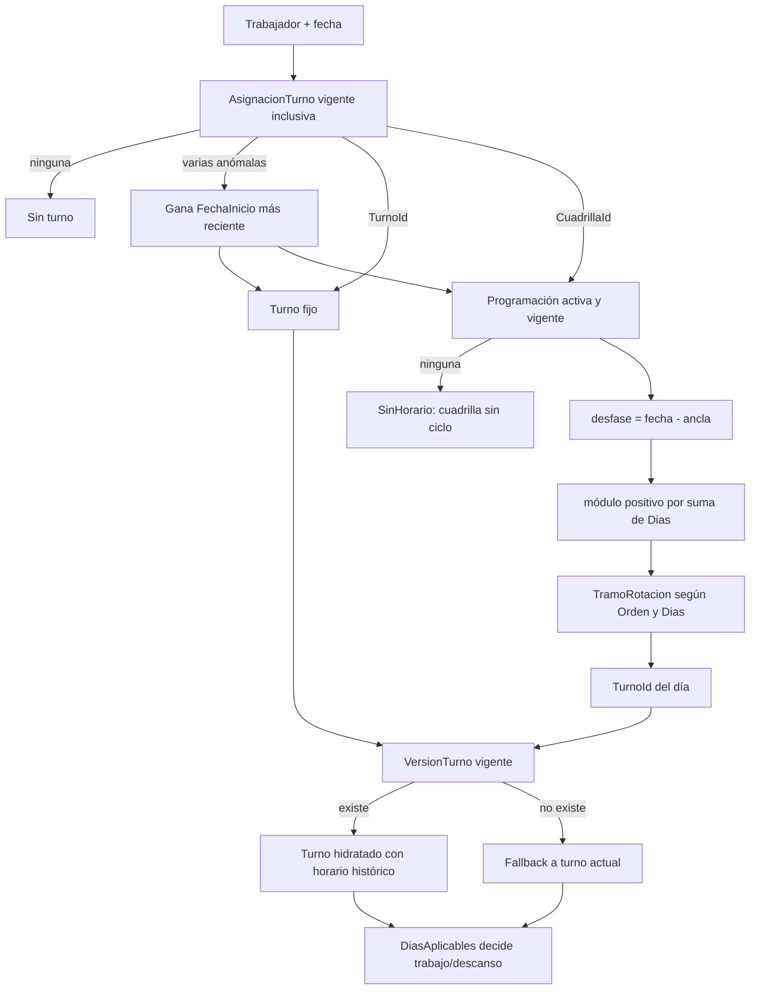

# D10 — Resolución histórica de turno y rotación

No hay un tramo “descanso”. Cada tramo apunta a un turno y el turno decide los días aplicables. El tareo persiste `TurnoId`, pero no `VersionTurnoId` ni `ProgramacionCuadrillaId`.

