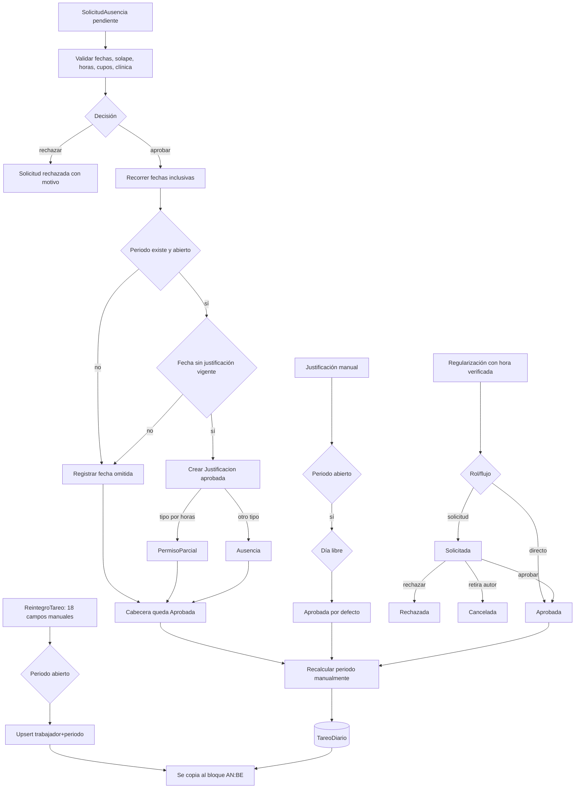

# D11 — Solicitud, justificación, regularización y reintegro

Solicitud/justificación alteran el resultado diario después de recalcular. Reintegro no altera el tareo: complementa directamente el Excel.

