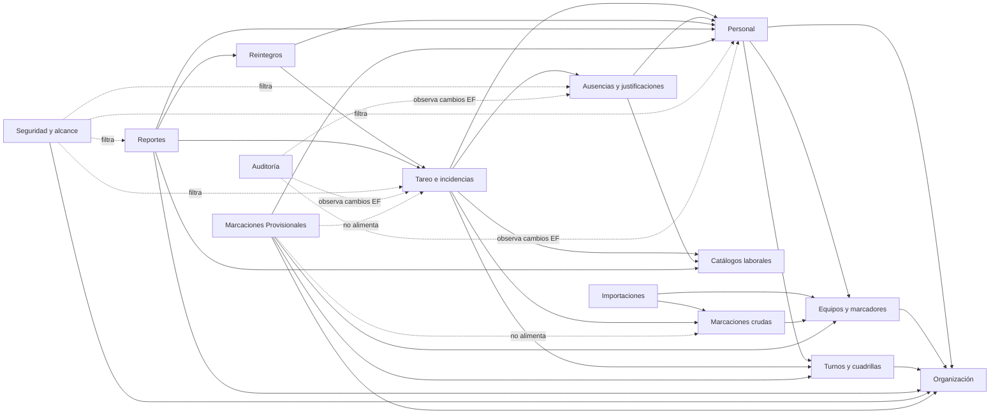

# D13 — Dependencias funcionales entre módulos

Los módulos son fronteras funcionales inferidas; no existen como ensamblados independientes. Las dependencias más densas se concentran en tareo y reportes. PMV lee equipos, padrón, organización y turnos, pero su persistencia queda en tablas `prov_*` y no alimenta el motor principal. La autorización por rol existe, pero el filtro de alcance por planta de Seguridad no se aplica a PMV.
