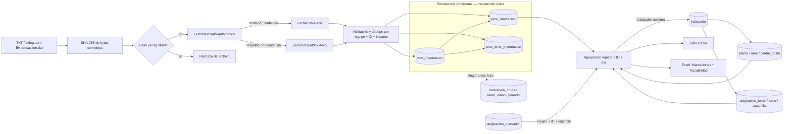

# D14 — Flujo de datos de Marcaciones Provisionales

Precisiones:

- La flecha punteada hacia el sistema principal expresa una frontera verificada: PMV no escribe esas tablas.
- `trabajador` es opcional en el resultado. Una marca sin asignación histórica se conserva y se muestra como “Sin asignar”.
- La atribución del ID es histórica; planta, área y centro de costo se leen de la ficha actual.
- Más de 40 días bloquea el Excel, no la consulta.
