# CONTROL_MARCACION_ERD — mapa físico general

Fecha de corte: 2026-10-16. Este mapa muestra las FK físicas principales del snapshot EF Core
y de la copia SQLite auditada. Las vistas modulares enlazadas al final contienen el detalle
legible. Una columna terminada en `_id` sin línea no debe interpretarse como FK.

```mermaid
erDiagram
    CLIENTE ||--o{ EMPRESA : cliente_id
    EMPRESA ||--o{ PLANTA : empresa_id
    PLANTA ||--o{ AREA : planta_id
    AREA ||--o{ SECCION : area_id
    EMPRESA ||--o{ CENTRO : empresa_id
    PLANTA o|--o{ CENTRO : planta_id
    CENTRO ||--o{ CENTRO_COSTO : centro_id

    TRABAJADOR ||--o{ PERIODO_LABORAL : trabajador_id
    EMPRESA ||--o{ PERIODO_LABORAL : empresa_id
    PERIODO_LABORAL ||--o{ ASIGNACION_PLANTA : periodo_laboral_id
    PLANTA ||--o{ ASIGNACION_PLANTA : planta_id
    TRABAJADOR ||--o{ ASIGNACION_AREA : trabajador_id
    AREA ||--o{ ASIGNACION_AREA : area_id
    TRABAJADOR ||--o{ ASIGNACION_MARCADOR : trabajador_id
    EQUIPO_MARCADOR ||--o{ ASIGNACION_MARCADOR : equipo_id
    TRABAJADOR ||--o{ ASIGNACION_TURNO : trabajador_id
    TURNO o|--o{ ASIGNACION_TURNO : turno_id
    CUADRILLA o|--o{ ASIGNACION_TURNO : cuadrilla_id
    TRABAJADOR ||--o{ ASIGNACION_SUELDO : trabajador_id

    PLANTA ||--o{ EQUIPO_MARCADOR : planta_id
    EQUIPO_MARCADOR ||--o{ MARCADOR : equipo_id
    PLANTA ||--o{ MARCADOR : planta_id
    EQUIPO_MARCADOR ||--o{ IMPORTACION_MARCADOR : equipo_id
    IMPORTACION_MARCADOR ||--o{ ERROR_IMPORTACION : importacion_id
    IMPORTACION_MARCADOR ||--o{ MARCACION_CRUDA : importacion_id
    EQUIPO_MARCADOR ||--o{ MARCACION_CRUDA : equipo_id

    TURNO ||--o{ VERSION_TURNO : turno_id
    TURNO ||--o{ TURNO_PLANTA : turno_id
    PLANTA ||--o{ TURNO_PLANTA : planta_id
    PLANTA ||--o{ CUADRILLA : planta_id
    CUADRILLA ||--o{ PROGRAMACION_CUADRILLA : cuadrilla_id
    PROGRAMACION_CUADRILLA ||--o{ TRAMO_ROTACION : programacion_id
    TURNO o|--o{ TRAMO_ROTACION : turno_id

    TIPO_AUSENCIA ||--o{ SOLICITUD_AUSENCIA : tipo_ausencia_id
    SOLICITUD_AUSENCIA o|--o{ JUSTIFICACION : solicitud_ausencia_id

    EQUIPO_MARCADOR ||--o{ PROV_IMPORTACION : equipo_id
    PROV_IMPORTACION ||--o{ PROV_MARCACION : importacion_provisional_id
    PROV_IMPORTACION ||--o{ PROV_ERROR_IMPORTACION : importacion_provisional_id
    EQUIPO_MARCADOR ||--o{ PROV_MARCACION : equipo_id

    ASP_NET_USERS ||--o{ USUARIO_PLANTA : usuario_id
    PLANTA ||--o{ USUARIO_PLANTA : planta_id
    ASP_NET_USERS ||--o{ ASP_NET_USER_ROLES : user_id
    ASP_NET_ROLES ||--o{ ASP_NET_USER_ROLES : role_id
```

Entidades aisladas en este mapa no significan tablas huérfanas. `periodo`, `tareo_diario`,
`reintegro_tareo`, `feriado`, `parametro_legal`, `tasa_sobretasa` y `registro_auditoria`
participan mediante IDs lógicos o consultas, pero no tienen FK físicas hacia los agregados
mostrados. Las siete tablas internas de ASP.NET Core Identity se detallan como grupo en el
catálogo físico.

Vistas modulares:

- [ERD_TRABAJADORES.md](ERD_TRABAJADORES.md)
- [ERD_MARCACIONES.md](ERD_MARCACIONES.md)
- [ERD_TAREO.md](ERD_TAREO.md)
- [ERD_PMV.md](ERD_PMV.md)

