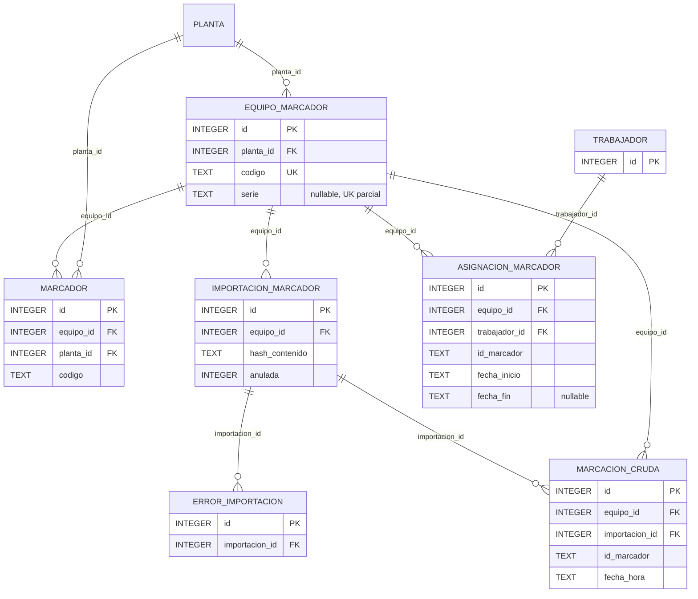

# ERD_MARCACIONES — importación y atribución

`marcacion_cruda` no tiene `trabajador_id`. La relación con el trabajador no es FK: se resuelve
por `(equipo_id, id_marcador, fecha_hora)` contra la vigencia inclusiva de
`asignacion_marcador`. No existe una tabla puente entre marcas consumidas y `tareo_diario`.

