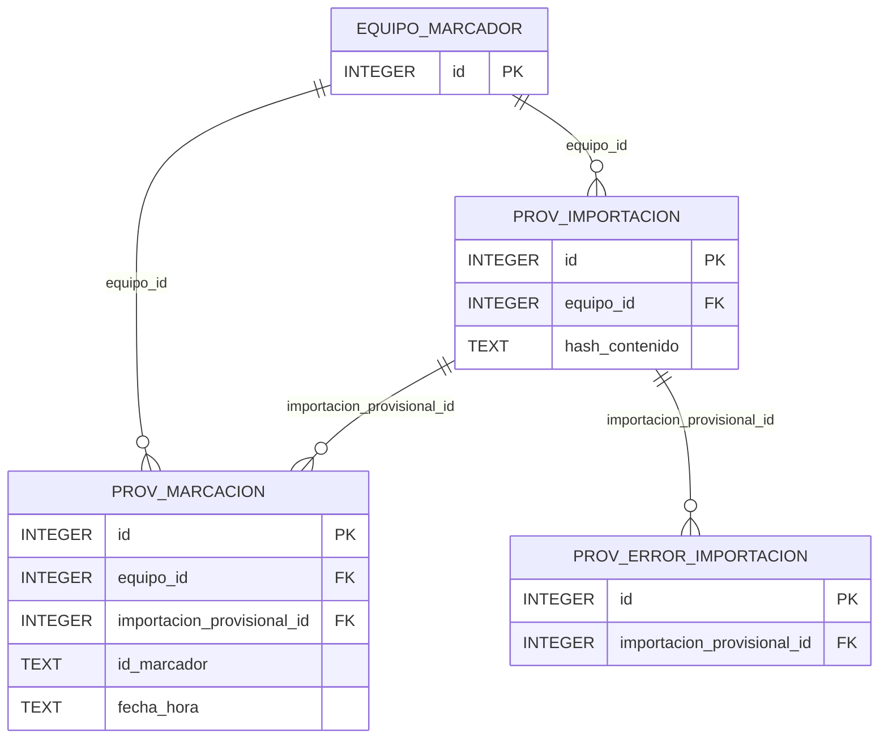

# ERD_PMV — marcaciones provisionales

PMV es un módulo físicamente separado. No tiene FK ni escritura hacia `marcacion_cruda`,
`importacion_marcador`, `tareo_diario` o planilla. La atribución a trabajador se calcula en
consulta mediante equipo + identificador + vigencia de `asignacion_marcador`; no se persiste.

