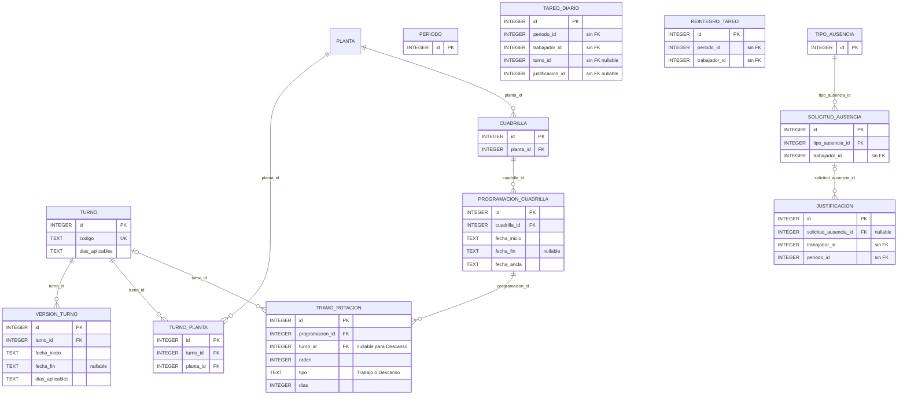

# ERD_TAREO — turnos, rotación y resultados

No existen tablas `rotacion`, `version_rotacion`, `jornada` ni `dias_aplicables`. La secuencia
real es finita: `programacion_cuadrilla` contiene tramos ordenados y solo resuelve fechas entre
su ancla y el total materializado. `tramo_rotacion.tipo` usa `Trabajo` o `Descanso`; el segundo
es `DescansoProgramado`, dura un día y exige `turno_id IS NULL`.

