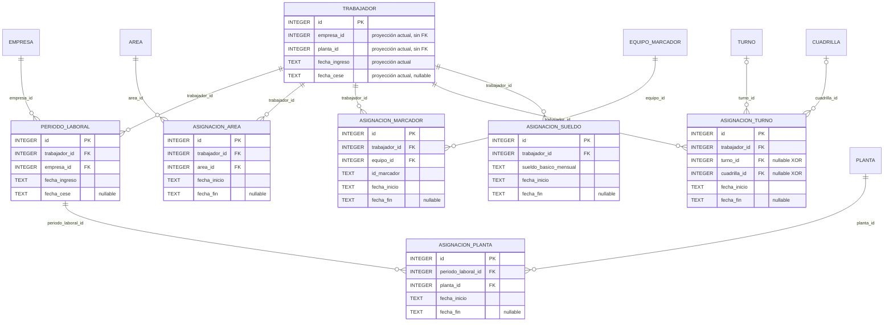

# ERD_TRABAJADORES — vínculo y organización

`PeriodoLaboral` es la autoridad histórica del vínculo y `AsignacionPlanta` la autoridad
histórica de planta dentro del vínculo. Los cuatro campos planos indicados de `trabajador` son
proyección actual/compatibilidad, no historia. `AsignacionTurno` exige físicamente exactamente
una de `turno_id` o `cuadrilla_id`.

